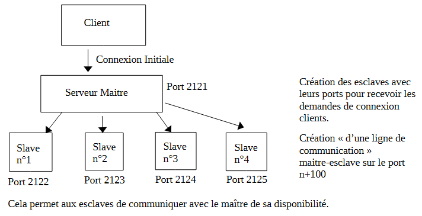
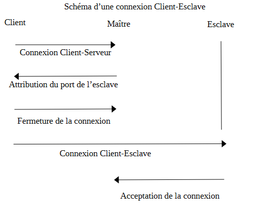
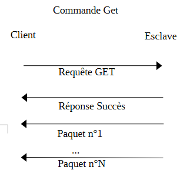
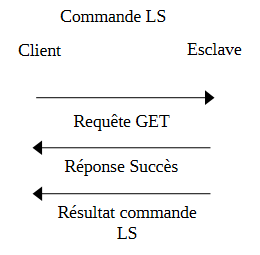

# CR TP_FTP
* CALIBRE Anselme
* WOODING Colin
* Groupe BD

## Fonctionnement et exécution
Pour compiler, il faut effectuer la commande **make** dans le répertoire racine du projet. 
Les exécutables du client et du serveur se trouvent donc repectivement dans les dossiers **CLIENT** et **SERVEUR**. 
Le serveur se lance avec la commande **./serveurpool** en se trouvant dans le dossier **SERVEUR**. Le client se lance avec la commande **./client** lorsqu'on se situe dans le dossier **CLIENT**. 
Pour des questions de lisibilité et de sécurité (pour ne pas accéder au code source du serveur directement), nous avons choisi de placer les fichiers téléchargeables dans un sous répertoire du serveur nommé **DATA**.
Le fonctionnement pour le client est similaire, uniquement par soucis de lisibilité cette fois ci. Cependant, un fichier que l'on demande au serveur se créera dans le client, ce fichier est temporaire. Tant qu'il n'est pas complet (transféré en entier), il restera dans ce dossier, et on pourra reprendre son téméchargement là où il s'était arrété. Une fois qu'il sera complet, on le déplacera dans un sous-dossier nommé **/DATA**. 
Les requêtes possibles par le client sont get \<nom_fichier\> et ls \<option\> où option représente les options possibles au ls en bash, mais on ne peut mettre qu'une option à la fois, et bye qui permet de se déconnecter du serveur. 
Lorsqu'un esclave a communiqué avec un client, il ne signale pas au maître qu'il est de nouveau disponible pour servir un autre client. Une fois que tous les esclaves ont servi un client, il n'est plus possible pour un client d'être servi, à moins de relancer le serveur. 



## Protocole de Communication

Pour une requête ( client -> serveur ):
```c
request_t{
    type ( GET, PUT, LS, INCONNU );         //Pour gérer le type de requête envoyé
    fic;                                     //Le nom du fichier ou l'argument pour une requête LS
    numero;                                 //Le numéro du paquet depuis lequel télécharger ou rien pour LS
    index;                                 //Le numéro de l'offset depuis lequel télécharger ou rien pour LS
}
```

Pour une réponse ( serveur -> client ):
```c
response_t{
    numero                                              //Le numéro du paquet envoyé
    total                                               //Le nombre total de paquet à envoyer
    taille                                              //La taille d'un paquet
    type ( SUCCES, FICHIER_INEXISTANT, ERREUR_REQ )      //Le type de la réponse                                   
}  
```

## Connexion Client-esclave



Pour connecter un client au serveur, le client commence par envoyer une requête de connexion au Maître. S'il reste des esclaves libres, celui-ci en sélectionne un, le réserve et envoie le port de connexion au client. Une fois celà fait, il rompt la connexion avec le Maitre et envoie une requête de connexion à l'esclave. Celui-ci l'accepte et il est maintenant possible d'envoyer des requêtes client-serveur.

## Commande GET

Pour une commande GET, le client (déjà connecté au serveur), commence par essayer d'ouvrir un fichier avec le nom donné dans la requête. Si celui-ci existe, c'est qu'un précédent téléchargement de ce fichier avait été initié mais n'avait pas été terminé et, il faut donc reprendre le téléchargement depuis le dernier paquet non entièrement reçu. Si le fichier n'existe pas, il faut donc le créer.
Après cela, le client envoie sa requête au serveur. Celui-ci la lit et traite la demande. Le serveur récupère le contenu du fichier comme demandé par le client. Il va ensuite envoyer une réponse pour donner le header du paquet et le paquet. En même temps, le client va lire le header pour bien récuperer son paquet. Une fois l'ensemble des paquets récupéré par le client, il va déplacer le fichier téléchargé dans son sous répertoire **/DATA**.

## Commande LS

Pour une commande LS, le client (déjà connecté au serveur) prépare sa requête à envoyer au serveur ainsi que les arguments possible pour notre commande ls. Il va ensuite envoyer la requête au serveur et celui-ci va la traiter. Il va stocker dans un buffer l'ensemble du contenu de notre commande avant d'envoyer en une fois le buffer. Nous avons supposé que si la récéption du message était interrompu, stocker une partie de son contenu ne serait pas utile. Le client traitera la réponse en affichant dans la sortie standard le contenu du buffer et donc le contenu des fichiers du serveur. 

## Proposition d'une reconnexion en cas de panne de serveur esclave

Pour vérifier si le serveur est en panne, nous créons un timer qui mesure le temps pour qu'un paquet lui arrive. Si le temps est dépassé, c'est que l'esclave est en panne. A ce moment-là, le client envoie une requête de reconnection au maître qui va lui trouver un nouvel esclave disponible. Une fois celà fait, le client renvoie la requête (le client stockera toujours sa dernière requête envoyée) qui était en cours de traitement par l'esclave, pour poursuivre et terminer ce qu'il avait commencé avec l'esclave tombé en panne.